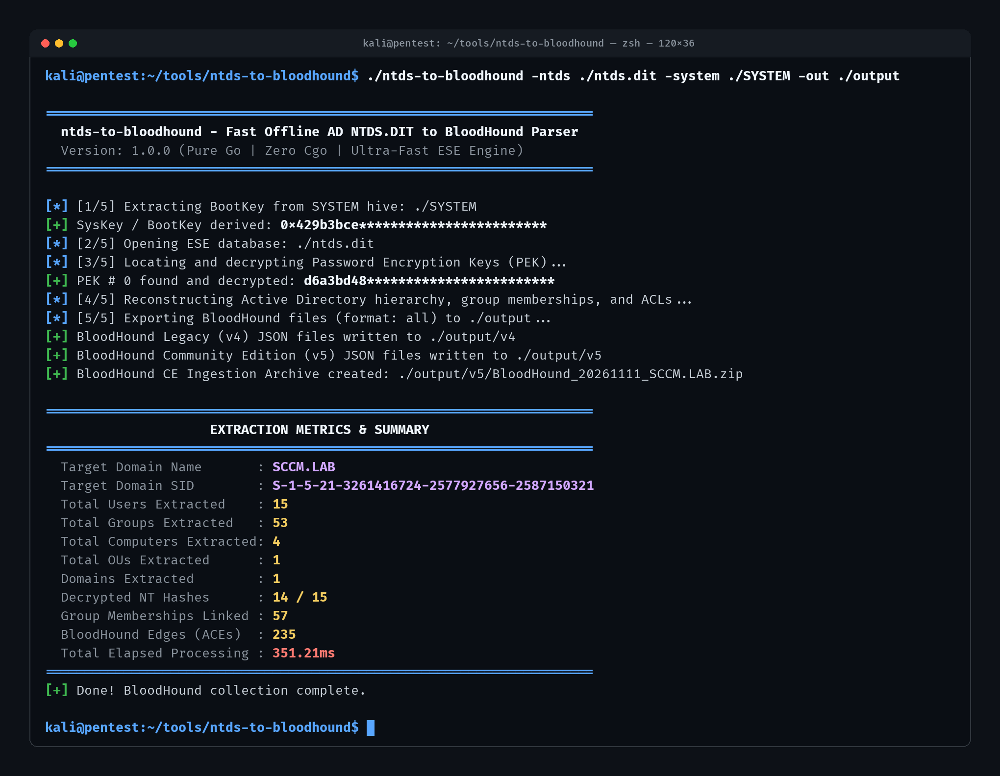

# ntds-to-bloodhound

Offline Active Directory database (`ntds.dit`) parser and BloodHound graph reconstructor. Extracts directory objects, group memberships, domain trust topology, and binary Security Descriptors (ACEs) directly from dead-disk database pages and registry hives without LDAP queries, RSAT, or a live Domain Controller.



## Table of Contents

- [Why / The Gap This Fills](#why--the-gap-this-fills)
- [Internal Pipeline](#internal-pipeline)
- [Required Files](#required-files)
- [Build](#build)
- [Usage](#usage)
  - [BloodHound Community Edition (v5)](#bloodhound-community-edition-v5)
  - [BloodHound Legacy (v4)](#bloodhound-legacy-v4)
  - [Export Hashes and Graph Simultaneously](#export-hashes-and-graph-simultaneously)
- [Ingestion into BloodHound](#ingestion-into-bloodhound)
  - [BloodHound CE (v5)](#bloodhound-ce-v5)
  - [BloodHound Legacy (v4)](#bloodhound-legacy-v4-1)
  - [Querying Decrypted Hashes in BloodHound](#querying-decrypted-hashes-in-bloodhound)
- [License](#license)

## Why / The Gap This Fills

Active Directory collectors (SharpHound, BloodHound.py, adalanche) rely on live network enumeration over LDAP, SAMR, and SMB. In red team engagements involving volume shadow copies, offline disk images, isolated backups, or heavily monitored environments where LDAP querying is restricted or triggers behavioral alerts, running live collectors is not an option.

Existing offline workflows typically run `secretsdump.py` against `ntds.dit` to dump password hashes. While effective for credential harvesting, `secretsdump.py` discards all structural Active Directory metadata: nested group memberships, OU containment hierarchies, domain trusts, and Windows NT Security Descriptors (ACLs). Reconstructing the BloodHound attack graph previously required restoring the database into an isolated Windows Server VM or chaining disparate Python and C scripts dependent on external libraries like `libesedb`.

`ntds-to-bloodhound` solves this with a standalone Go binary with zero Cgo and zero external dependencies. It parses raw Extensible Storage Engine (ESE) database pages, decrypts PEK-wrapped account secrets, reconstructs the directory tree, decodes binary DACLs into BloodHound attack relationships, and outputs ready-to-ingest BloodHound CE (v5) and legacy (v4) packages.

## Internal Pipeline

The extraction engine operates entirely offline in memory through five stages:

### SysKey & PEK Recovery
The parser reads the offline `SYSTEM` registry hive, extracts permutation vectors across `JD`, `Skew1`, `GBG`, and `Data` under `Control\Lsa`, and reconstructs the 16-byte BootKey (SysKey). It streams `ntds.dit` to locate the domain PEK record (`ATTk590689`) and decrypts the active encryption keys using RC4 or AES.

### Directory Assembly
Using a native pure-Go ESE database reader, the engine traverses the directory `datatable` and resolves fixed, variable, and tagged columns against schema definitions. It reconstructs organizational unit containment hierarchies, resolves primary group IDs, and indexes direct and nested group memberships.

### Credential Decryption
For accounts containing encrypted password attributes (`unicodePwd`), the engine decrypts the ciphertext using the matching PEK key and strips the final RID-based DES obfuscation layer. Decrypted values are attached as `nthash` node properties on User and Computer objects.

### Security Descriptor Translation
Binary Windows NT Security Descriptors (`nTSecurityDescriptor`) are retrieved from `sd_table` and parsed into owner and discretionary access control entries. Trustee SIDs, access masks, and schema GUIDs are resolved into typed BloodHound relationship edges including `Owns`, `GenericAll`, `WriteDacl`, `WriteOwner`, `GenericWrite`, `AllExtendedRights`, `ForceChangePassword`, `AddMember`, `AddSelf`, `GetChanges`, and `GetChangesAll`.

### Output Serialization
Validated graph models are written to disk. In Community Edition mode, the output is formatted as JSON arrays and packaged into a timestamped ingestion ZIP file. In legacy mode, individual v4 JSON files are exported.

## Required Files

| File | Source Path | Description |
|---|---|---|
| `ntds.dit` | `C:\Windows\NTDS\ntds.dit` | Active Directory database |
| `SYSTEM` | `C:\Windows\System32\config\SYSTEM` | Registry hive containing the syskey |

## Build

Requires Go 1.21+.

```bash
make build
```

Cross-compile for Linux, Windows, and macOS:

```bash
make build-all
```

Compiled binaries are output to the repository root (`./ntds-to-bloodhound`).

## Usage

```text
Usage: ntds-to-bloodhound [OPTIONS]

Required Flags:
  -n, -ntds string
        Path to offline ntds.dit database file
  -s, -system string
        Path to offline SYSTEM registry hive file

Optional Flags:
  -o, -out string
        Output directory for generated files (default: "./output")
  -f, -format string
        Output format: "v4" (Legacy), "v5" (Community Edition), or "all" (default: "all")
  -d, -dump-hashes string
        Path to write secretsdump-compatible credential file
      -domain string
        Override Active Directory domain FQDN if not auto-detected
      -zip
        Package v5 output into BloodHound ingestion ZIP archive (default: true)
  -v, -verbose
        Enable detailed debug logging
  -h, -help
        Show help information
```

### BloodHound Community Edition (v5)

Generate a timestamped ZIP archive ready for BloodHound CE:

```bash
./ntds-to-bloodhound -ntds /path/to/ntds.dit -system /path/to/SYSTEM -format v5 -out ./output
```

```text
[*] [1/5] Extracting BootKey from SYSTEM hive: /path/to/SYSTEM
[+] SysKey / BootKey derived: 0x429b3bce************************
[*] [2/5] Opening ESE database: /path/to/ntds.dit
[*] [3/5] Locating and decrypting Password Encryption Keys (PEK)...
[+] PEK # 0 found and decrypted: d6a3bd48************************
[*] [4/5] Reconstructing Active Directory hierarchy, group memberships, and ACLs...
[+] Processed 15 users, 53 groups, 4 computers, 1 OUs, 1 domains
[*] [5/5] Exporting BloodHound files (format: v5) to ./output...
[+] BloodHound Community Edition (v5) JSON files written to ./output
[+] BloodHound CE Ingestion Archive created: ./output/BloodHound_20261111230000.zip
```

### BloodHound Legacy (v4)

Generate individual JSON files formatted for legacy BloodHound:

```bash
./ntds-to-bloodhound -ntds /path/to/ntds.dit -system /path/to/SYSTEM -format v4 -out ./output/v4
```

### Export Hashes and Graph Simultaneously

Dump credentials in `secretsdump.py` format (`user:RID:LM:NT:::`) while generating the graph:

```bash
./ntds-to-bloodhound \
  -ntds /path/to/ntds.dit \
  -system /path/to/SYSTEM \
  -dump-hashes ./output/hashes.txt \
  -out ./output
```

## Ingestion into BloodHound

### BloodHound CE (v5)

Upload the generated `BloodHound_<timestamp>.zip` archive directly through the BloodHound Community Edition interface under **Administration** &rarr; **File Ingest**, or post the archive to the CE ingestion REST endpoint.

### BloodHound Legacy (v4)

Drag and drop the generated JSON files (`users.json`, `groups.json`, `computers.json`, `ous.json`, `domains.json`) into the legacy BloodHound desktop GUI window.

### Querying Decrypted Hashes in BloodHound

`ntds-to-bloodhound` injects decrypted NT password hashes directly into the BloodHound node properties under the `nthash` key. You can query them in the Cypher console:

```cypher
MATCH (u:User) WHERE u.nthash IS NOT NULL RETURN u.name, u.nthash
```

Or view them in the node properties panel under the **Node Info** sidebar for any User or Computer object.

## License

Apache License 2.0
